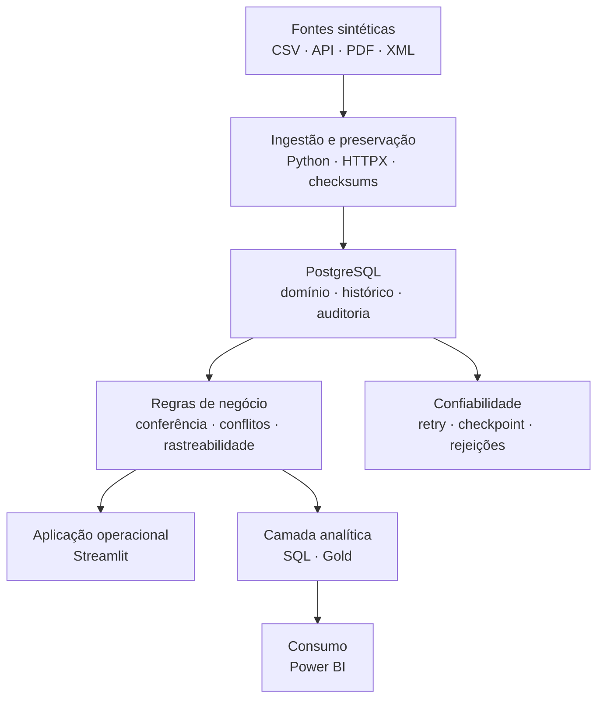
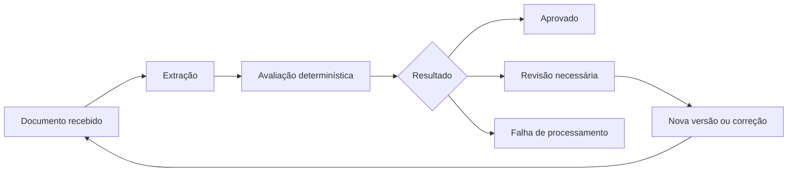

# Integrated Logistics Control — ILC

**Plataforma de dados e aplicação analítica para acompanhar entregas, confrontar eventos e documentos, rastrear divergências e apoiar decisões operacionais.**

Projeto autoral e educacional de **João Pedro Caneca**, desenvolvido com dados sintéticos. O ILC demonstra como transformar uma necessidade logística em ingestão rastreável, regras de negócio, persistência histórica, aplicação operacional e uma camada de consumo analítico.

> **Estado atual:** projeto em desenvolvimento, com foco na conclusão da F5 — aplicação local, métricas SQL, camada Gold e preparação do consumo no Power BI. As entregas já demonstradas permanecem documentadas por fase; o projeto ainda não representa uma solução pronta para produção.

[Portfólio](https://soba-jopeca.github.io/) · [Documentação](#documentação-e-artefatos) · [Estado das fases](#estado-das-fases) · [Limites](#limites-e-transparência)

## Problema de negócio

Pedidos, eventos de transporte e comprovantes podem estar distribuídos em fontes diferentes. Essa fragmentação dificulta responder com rapidez e segurança:

- quais entregas foram concluídas, mas ainda não possuem comprovante;
- quais documentos divergem dos dados operacionais;
- quais pendências exigem priorização;
- quando houve substituição, conflito ou falha de processamento;
- se o problema pertence à operação, ao documento ou ao pipeline de dados.

O projeto preserva uma regra central: **a conclusão física da entrega e a regularidade documental são estados independentes**.

## AS-IS e TO-BE

| AS-IS — situação inicial | TO-BE — solução proposta |
|---|---|
| Pedidos, eventos e documentos em fontes separadas | Informações relacionadas por identificadores, regras e histórico |
| Conferência documental manual e pouco rastreável | Extração e avaliação determinística com motivos explícitos |
| Um único status para representar toda a entrega | Estados físico e documental tratados separadamente |
| Reenvios e conflitos difíceis de investigar | Versionamento imutável, checksums e trilha de decisões |
| Indicadores construídos diretamente sobre dados operacionais | Camada Gold com grão, corte temporal e regras documentadas |
| Falhas percebidas apenas no resultado final | Auditoria de captura, rejeições, retries e checkpoints |

## Solução construída

O ILC foi estruturado para:

1. consumir eventos de uma API local simulada e importar dados sintéticos;
2. preservar origem, conteúdo, checksum, tentativas e decisões;
3. armazenar o domínio no PostgreSQL com migrações Alembic;
4. tratar idempotência, conflitos, falhas controladas e retomada;
5. extrair campos de documentos PDF textual e XML educacional;
6. avaliar documentos por regras determinísticas e explicar divergências;
7. disponibilizar consulta, filtros, detalhes e histórico em Streamlit;
8. produzir métricas SQL e publicações analíticas na camada Gold;
9. preparar o consumo no Power BI sem misturar o grão operacional com o analítico;
10. manter experimentos locais de IA isolados do fluxo de aprovação.

## Arquitetura da solução

### Fluxo de decisão documental

O recebimento ou a extração de um documento **não significa aprovação**. A versão utilizada, a avaliação, os motivos e o vínculo com a entrega permanecem rastreáveis.

## Evidências já demonstradas

| Evidência | Resultado documentado | Observação |
|---|---|---|
| Ambiente e persistência | PostgreSQL dedicado, SQLAlchemy e migrações Alembic | Ambiente local e dados sintéticos |
| Modelo de dados | Histórico, vínculos, restrições e decisões de domínio | Modelos conceitual, lógico e físico documentados |
| API de eventos | FastAPI, OpenAPI, paginação e falhas controladas | API simulada, limitada ao ambiente local |
| Confiabilidade | Idempotência, conflitos explícitos, retry, checkpoint e retomada | F3 fechada com limitações |
| Regressão F3 | **98 testes aprovados** no ambiente Windows/PostgreSQL documentado | Suítes posteriores podem reutilizar casos; totais não devem ser somados |
| Documentos | Extração PDF/XML, versionamento e avaliação determinística | IA permanece experimental e sem poder de aprovação |
| Aplicação | Busca, filtros, detalhes, upload e histórico em Streamlit | Jornada final com navegador e banco integra a conclusão da F5 |
| Analytics | Métricas M1–M4, corte temporal e estrutura Gold | Publicação e consumo final seguem em validação |

## O que este projeto demonstra

- entendimento do problema antes da escolha tecnológica;
- separação entre estado físico, documental e técnico;
- contratos de dados e regras de negócio explícitas;
- modelagem relacional com histórico e rastreabilidade;
- ingestão idempotente e tratamento de falhas;
- APIs, processamento documental e aplicação operacional;
- SQL analítico com grão e corte temporal controlados;
- evolução por fases, critérios de aceite e registro de limitações;
- uso responsável de dados sintéticos e experimentos de IA.

## Estado das fases

| Fase | Escopo | Estado |
|---|---|---|
| **F1** | Negócio, escopo, arquitetura, contratos e modelo de dados | **Fechada documentalmente** |
| **F2** | Ambiente, PostgreSQL, Alembic, modelo físico e dados sintéticos | **Fechada com limitações** |
| **F3** | FastAPI, captura, carga, idempotência e recuperação | **Fechada com limitações** |
| **F4** | Extração, conferência documental, histórico e experimento local de IA | **Fechada com limitações** |
| **F5** | Streamlit, métricas SQL, camada Gold e Power BI | **Em desenvolvimento** |
| **F6** | CI/E2E, backup, recuperação, empacotamento e release | **Não iniciada** |

Os estados indicam o escopo demonstrado em cada fase. Não significam prontidão produtiva, integração automática de todas as branches ou conclusão integral do produto.

## Tecnologias

| Área | Tecnologias |
|---|---|
| **Dados e backend** | Python, SQL, PostgreSQL, SQLAlchemy, Alembic |
| **API e ingestão** | FastAPI, HTTPX, CSV, PDF e XML |
| **Aplicação e analytics** | Streamlit, SQL analítico, camada Gold, Power BI Desktop |
| **Qualidade** | Pytest, Ruff, validações determinísticas |
| **Engenharia** | Git, GitHub, configuração externa e dependências fixadas |
| **IA experimental** | Ollama e Qwen2.5, isolados do fluxo decisório |

## Documentação e artefatos

A documentação detalhada foi preservada para permitir rastreabilidade entre problema, decisões, implementação, provas e limitações.

<strong>F1 — Negócio, arquitetura, contratos e modelagem</strong>

- [01 — Entendimento do negócio](docs/01-business-understanding.md)
- [02 — Escopo e critérios de aceite](docs/02-scope-and-acceptance.md)
- [03 — Arquitetura](docs/03-architecture.md)
- [04 — Plano de entrega e aprendizagem](docs/04-delivery-and-learning-plan.md)
- [05 — Métricas e regras de negócio](docs/05-metrics-and-rules.md)
- [06 — Contratos de eventos e documentos](docs/06-event-and-document-contracts.md)
- [07 — Modelo conceitual e lógico](docs/07-conceptual-and-logical-model.md)
- [08 — Consolidação F1 e modelo analítico](docs/08-f1-consolidation-and-analytical-model.md)

<strong>F2 — Ambiente, banco de dados e dados sintéticos</strong>

- [09 — Ambiente reproduzível](https://github.com/Soba-Jopeca/integrated-logistics-control/blob/feat/f5-p03a-gold/docs/09-f2-p01-environment.md)
- [10 — PostgreSQL](https://github.com/Soba-Jopeca/integrated-logistics-control/blob/feat/f5-p03a-gold/docs/10-f2-p02a-postgresql.md)
- [11 — Migração do núcleo](https://github.com/Soba-Jopeca/integrated-logistics-control/blob/feat/f5-p03a-gold/docs/11-f2-p02b-core-migration.md)
- [12 — Migração documental](https://github.com/Soba-Jopeca/integrated-logistics-control/blob/feat/f5-p03a-gold/docs/12-f2-p02c-document-migration.md)
- [13 — Decisões e conflitos](https://github.com/Soba-Jopeca/integrated-logistics-control/blob/feat/f5-p03a-gold/docs/13-f2-p02d-decisions-conflicts.md)
- [14 — Gerador de dados sintéticos](https://github.com/Soba-Jopeca/integrated-logistics-control/blob/feat/f5-p03a-gold/docs/14-f2-p03-synthetic-generator.md)
- [15 — Consolidação F2](https://github.com/Soba-Jopeca/integrated-logistics-control/blob/feat/f5-p03a-gold/docs/15-f2-p04-consolidation.md)

<strong>F3 — API, ingestão e confiabilidade</strong>

- [16 — API de eventos](https://github.com/Soba-Jopeca/integrated-logistics-control/blob/feat/f5-p03a-gold/docs/16-f3-p01-events-api.md)
- [Especificação OpenAPI](https://github.com/Soba-Jopeca/integrated-logistics-control/blob/feat/f5-p03a-gold/docs/16-f3-p01-openapi.json)
- [17 — Falhas controladas](https://github.com/Soba-Jopeca/integrated-logistics-control/blob/feat/f5-p03a-gold/docs/17-f3-p01-controlled-failures.md)
- [18 — Captura da API](https://github.com/Soba-Jopeca/integrated-logistics-control/blob/feat/f5-p03a-gold/docs/18-f3-p02a-api-capture.md)
- [19 — Carga de negócio](https://github.com/Soba-Jopeca/integrated-logistics-control/blob/feat/f5-p03a-gold/docs/19-f3-p02b-business-load.md)
- [20 — Confiabilidade](https://github.com/Soba-Jopeca/integrated-logistics-control/blob/feat/f5-p03a-gold/docs/20-f3-p03-reliability.md)
- [21 — Consolidação F3](https://github.com/Soba-Jopeca/integrated-logistics-control/blob/feat/f5-p03a-gold/docs/21-f3-p04-consolidation.md)

<strong>F4 — Documentos, validação e IA experimental</strong>

- [22 — Extração documental](https://github.com/Soba-Jopeca/integrated-logistics-control/blob/feat/f5-p03a-gold/docs/22-f4-p01-document-extraction.md)
- [23 — Validação documental](https://github.com/Soba-Jopeca/integrated-logistics-control/blob/feat/f5-p03a-gold/docs/23-f4-p02-document-validation.md)
- [24 — Experimento local de IA](https://github.com/Soba-Jopeca/integrated-logistics-control/blob/feat/f5-p03a-gold/docs/24-f4-p03-local-ai-experiment.md)
- [25 — Consolidação F4](https://github.com/Soba-Jopeca/integrated-logistics-control/blob/feat/f5-p03a-gold/docs/25-f4-p04-consolidation.md)

<strong>F5 — Aplicação, analytics e camada Gold</strong>

- [26 — Aplicação local](https://github.com/Soba-Jopeca/integrated-logistics-control/blob/feat/f5-p03a-gold/docs/26-f5-p01-local-app.md)
- [27 — Referência analítica SQL](https://github.com/Soba-Jopeca/integrated-logistics-control/blob/feat/f5-p03a-gold/docs/27-f5-p02-sql-analytics.md)
- [28 — Power BI](https://github.com/Soba-Jopeca/integrated-logistics-control/blob/feat/f5-p03a-gold/docs/28-f5-p03-power-bi.md)
- [29 — Publicação analítica Gold](https://github.com/Soba-Jopeca/integrated-logistics-control/blob/feat/f5-p03a-gold/docs/29-f5-p03a-gold.md)

## Navegação técnica

A `main` funciona como apresentação pública e baseline documental. As implementações posteriores permanecem organizadas nas branches de fase:

- [F2 — ambiente e persistência](https://github.com/Soba-Jopeca/integrated-logistics-control/tree/docs/f2-p04-consolidation)
- [F3 — API, ingestão e confiabilidade](https://github.com/Soba-Jopeca/integrated-logistics-control/tree/feat/f3-p03-reliability)
- [F4 — processamento documental](https://github.com/Soba-Jopeca/integrated-logistics-control/tree/docs/f4-p04-consolidation)
- [F5 — aplicação, analytics e Gold](https://github.com/Soba-Jopeca/integrated-logistics-control/tree/feat/f5-p03a-gold)

Cada branch contém suas próprias instruções, dependências, evidências e limitações. A execução deve seguir a documentação da fase correspondente.

## Limites e transparência

- Dados, documentos, empresas e operações são sintéticos ou educacionais.
- Não existe integração com ERP, WMS ou TMS corporativos reais.
- O projeto não representa a arquitetura ou os processos de uma empresa específica.
- Não há ganhos financeiros ou operacionais empresariais medidos.
- A execução atual é local e não representa um ambiente produtivo.
- O experimento de IA não aprova documentos nem altera decisões do domínio.
- Imagens da aplicação, diagramas exportados e demonstrações serão adicionados após a validação das jornadas correspondentes.
- CI/E2E, backup, recuperação e release permanecem no escopo da F6.

## Próximos passos

- concluir as validações restantes da F5;
- registrar capturas reais da aplicação e da camada analítica;
- consolidar métricas SQL, Gold e consumo no Power BI;
- organizar a integração controlada das branches aprovadas;
- publicar uma demonstração curta e reproduzível;
- iniciar a F6 somente após o fechamento da F5.

---

**Autor:** [João Pedro Caneca](https://github.com/Soba-Jopeca)  
**Portfólio:** [soba-jopeca.github.io](https://soba-jopeca.github.io/)  
**LinkedIn:** [joao-caneca](https://www.linkedin.com/in/joao-caneca/)
