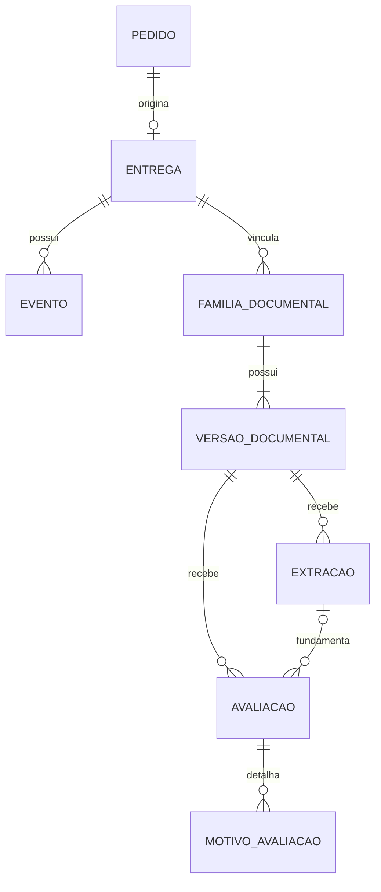
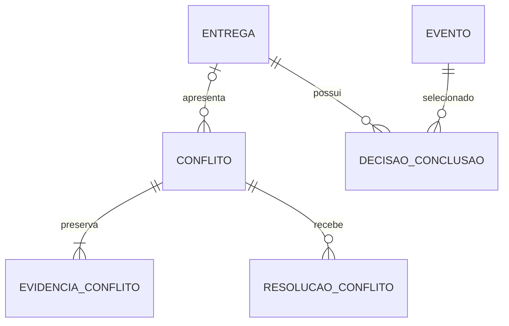
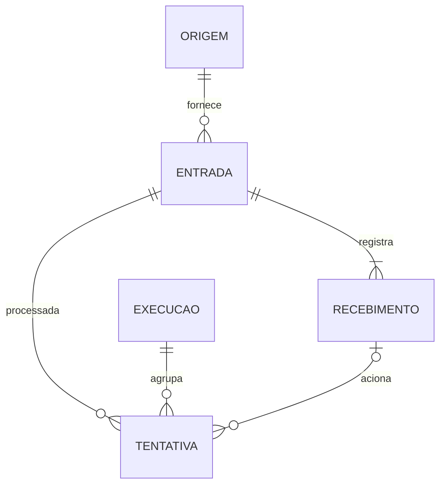

# 07 — Modelagem conceitual e lógica

Data: 16/10/2026.
Passo: F1-P03.
Estado: proposta para validação central.
Branch de trabalho: docs/data-contracts.
Contrato de referência: docs/06-event-and-document-contracts.md,
commit 58a1ec33f893ce3c0d3fe449c070966410e9d751.
Base técnica confirmada: 54fc765bac2cacf8591ffa354601b5287741f82f.

Modelagem documental de um case educacional com dados sintéticos.
Não comprova implementação, execução de fixtures ou testes de software.

## 1. Convenções

- PK: chave primária interna, imutável.
- FK: referência a outra entidade.
- Chaves internas: tipo lógico UUID, salvo run_id e source_system,
  representados como texto não vazio.
- Identificadores externos: texto, preservando as regras do contrato.
- Horários: data/hora com fuso, normalizados para UTC.
- Quantidades e números de versão: inteiros.
- Campos não declarados opcionais são obrigatórios.
- Nulos representam ausência conhecida; não são substituídos por
  valores inventados.
- Exclusão de registros referenciados não deve apagar histórico em cascata.
- As restrições descritas são lógicas. A forma de implementá-las
  será definida nas fases posteriores autorizadas.
- Os campos de negócio do contrato continuam aplicáveis; este
  dicionário acrescenta estrutura, relacionamentos e rastreabilidade.

## 2. Relações principais

Pedido e entrega são entidades separadas:
pedido registra a solicitação; entrega registra sua execução.

Na v1, cada pedido pode ter zero ou uma entrega.
Cada entrega pertence obrigatoriamente a um pedido.
O limite de uma entrega por pedido preserva a premissa da v1,
permitindo registrar o pedido antes de criar sua entrega.

O diagrama representa entidades de domínio aceitas e vinculadas.
Entradas inválidas ou com referência desconhecida permanecem na
rastreabilidade, sem criar entregas ou documentos fictícios.

A família documental é criada juntamente com sua primeira versão aceita.
Uma família aceita possui pelo menos uma versão.

## 3. Dicionário complementar do domínio

| Entidade | Grão | Chaves e vínculos | Campos e nulos |
|---|---|---|---|
| PEDIDO | Uma solicitação | PK order_key; único (source_system, order_id); FK source_system | released_at obrigatório; dados da solicitação preservados |
| ENTREGA | Uma execução | PK delivery_key; FK order_key obrigatória e única; delivery_id único no case | promised_at pode ser nulo; expected_quantity inteiro não negativo e quantity_unit obrigatórios |
| EVENTO | Um acontecimento aceito | PK event_key; único (source_system, event_id); FK delivery_key obrigatória | Campos do contrato; accepted_at e acceptance_sequence obrigatórios; sequência única por entrega |
| FAMILIA_DOCUMENTAL | Um comprovante ao longo de suas versões | PK family_key; único (source_system, document_family_id); FK delivery_key obrigatória | Não permite mudar de entrega por substituição |
| VERSAO_DOCUMENTAL | Uma versão aceita e imutável | PK document_key; único (source_system, document_id) e (family_key, version); FK family_key obrigatória | supersedes_document_key nulo somente na v1; hash, tipo e referência do arquivo obrigatórios |
| EXTRACAO | Uma tentativa de extração | PK extraction_key; FKs document_key e attempt_id obrigatórias | Campos extraídos podem ser nulos; versão do extrator, resultado e horário obrigatórios |
| AVALIACAO | Uma conferência versionada | PK evaluation_key; FKs document_key e attempt_id obrigatórias; extraction_key opcional | Resultado, versão das regras e horário obrigatórios; previous_evaluation_key opcional; autor e justificativa obrigatórios para revisão manual |
| MOTIVO_AVALIACAO | Um motivo em uma avaliação | PK reason_key; FK evaluation_key obrigatória | Código obrigatório; campo afetado e detalhe opcionais; não repetir o mesmo código/campo na mesma avaliação |

### 3.1 Identidade da entrega

delivery_id é globalmente único dentro deste case.
Assim, eventos e documentos de origens distintas podem apontar
para ENT-001 sem ambiguidade.

Integrações com identificadores locais exigiriam mapeamento adicional,
fora da v1.

Essa é uma decisão proposta da modelagem, sujeita à validação central.

### 3.2 Dados esperados da entrega

- expected_quantity: total esperado, inteiro não negativo.
- quantity_unit: unidade de comparação, texto não vazio.
- promised_at: prazo prometido; pode estar ausente.
- Quantidade parcial e conversão entre unidades não pertencem à v1.
- Alterações futuras dos valores esperados não podem modificar
  silenciosamente a explicação de avaliações anteriores.

### 3.3 Referências de avaliação

Cada avaliação preserva:

- Valores esperados utilizados na comparação.
- Evento de conclusão considerado, quando disponível.
- Extração utilizada, quando disponível.
- Versão das regras.
- Resultado, horário e motivos.
- Avaliação anterior, quando representar revisão.

O evento selecionado deve pertencer à entrega do documento.
A extração selecionada deve pertencer à mesma versão documental.
A avaliação anterior deve pertencer ao mesmo documento.
Não são permitidos ciclos na cadeia de revisões.

O vínculo com evento de conclusão pode ser nulo quando faltar
confirmação física. Nesse caso, a avaliação registra o bloqueador
e não produz aprovação.

### 3.4 Extração e avaliação separadas

Uma extração pode fundamentar zero ou várias avaliações.
Uma avaliação referencia zero ou uma extração.

Quando houver vínculo, extração e avaliação devem pertencer
à mesma versão documental.

A extração é imutável.
Novas regras geram nova avaliação.
Novo processamento do arquivo gera outra extração.

Avaliação sem extração somente registra bloqueadores,
como falha de parsing; nunca pode produzir APPROVED.

Consequência:
reavaliar regras não exige repetir o parser e mantém rastreável
o conteúdo que fundamentou cada resultado.

### 3.5 Resultados e motivos

O resultado da avaliação usa APPROVED ou REVIEW_REQUIRED.

NOT_EVALUATED representa ausência de avaliação selecionada;
não exige criar uma avaliação fictícia.

APPROVED não admite motivos bloqueadores.
REVIEW_REQUIRED exige pelo menos um motivo.

Os códigos de motivo são os definidos no contrato:
MISSING_REQUIRED_FIELD, INVALID_REFERENCE, REFERENCE_MISMATCH,
VALUE_MISMATCH, PARSING_ERROR, DELIVERY_NOT_CONFIRMED
e IDENTITY_CONFLICT.

Pendências que ainda não possuem documento aceito permanecem
registradas na entrada, tentativa ou conflito correspondente.

## 4. Histórico e vigência

“Último recebido” não significa “vigente”.
A seleção de versões e avaliações deve ser explícita e rastreável.

| Entidade | Grão e chaves | Restrições e nulos |
|---|---|---|
| VIGENCIA_DOCUMENTAL | Um intervalo de vigência; PK document_validity_key; FKs family_key e document_key | valid_from obrigatório; valid_to nulo apenas no intervalo aberto; documento deve pertencer à família; sem sobreposição; no máximo um intervalo aberto por família |
| VIGENCIA_AVALIACAO | Um intervalo de seleção de avaliação; PK evaluation_validity_key; FKs document_key e evaluation_key | valid_from obrigatório; valid_to nulo apenas no intervalo aberto; avaliação deve pertencer ao documento; sem sobreposição; no máximo um intervalo aberto por documento |
| DECISAO_CONCLUSAO | Uma escolha registrada de conclusão; PK completion_decision_key; FKs delivery_key e event_key | decided_at, tipo e motivo obrigatórios; autor obrigatório na resolução manual; previous_decision_key opcional |

Intervalos são tratados como [valid_from, valid_to):
incluem o início e excluem o fim.
Quando houver fim, ele deve ser posterior ao início.

Uma família aceita possui uma versão vigente.
A troca de vigência encerra o intervalo anterior e inicia o seguinte
na mesma operação lógica, sem janela com duas versões vigentes.

A vigência documental muda na aceitação estrutural da substituição.
A aprovação da versão anterior não é transferida.

A avaliação selecionada deve ter sido produzida até o início
de seu intervalo de seleção.
Uma avaliação antiga permanece no histórico mesmo após substituição.

As decisões de conclusão formam uma sequência sem ciclos.
A escolha atual é a última decisão da sequência de aceitação persistida,
não a de maior occurred_at.

## 5. Estados independentes

A situação física é derivada dos eventos e das decisões de conclusão:

- NOT_CONFIRMED.
- DISPATCHED.
- IN_TRANSIT.
- DELIVERED.

Conflito aberto é uma condição adicional e não apaga a conclusão
já aceita provisoriamente.

A regularidade documental é derivada separadamente:

- Pelo menos uma versão vigente aprovada.
- Nenhuma versão vigente vinculada com pendência.
- Nenhum bloqueador de conclusão que impeça usar essa aprovação.

Ausência de documento não regride a situação física.
Recebimento ou extração não significa aprovação.

Versões substituídas e avaliações anteriores permanecem consultáveis,
mas não são confundidas com a situação atual.

## 6. Conflitos

Cada conflito referencia zero ou uma entrega.
O vínculo permanece nulo enquanto a referência não for resolvida.
Uma entrega pode possuir zero ou vários conflitos.

| Entidade | Grão e chaves | Campos e restrições |
|---|---|---|
| CONFLITO | Um caso de conflito; PK conflict_key; FK delivery_key opcional | Tipo e opened_at obrigatórios; vínculo pode estar pendente |
| EVIDENCIA_CONFLITO | Uma evidência preservada; PK conflict_evidence_key; FKs conflict_key e input_key obrigatórias | Referência a evento ou documento aceito é opcional; papel da evidência obrigatório |
| RESOLUCAO_CONFLITO | Uma decisão sobre um conflito; PK resolution_key; FK conflict_key obrigatória | Autor, horário, motivo e decisão obrigatórios; imutável; resolução anterior opcional |

Cada conflito possui evidência suficiente para identificar
o original e a alternativa.
Resolvido não significa apagado.
Eventual revisão da resolução preserva a decisão anterior.

### 6.1 Conflito de identidade

Mesma origem e mesmo identificador com conteúdo diferente:

- Não cria um segundo evento ou documento aceito com a mesma chave.
- Preserva a entrada alternativa.
- Relaciona a alternativa ao registro original.
- Não sobrescreve o conteúdo aceito.

### 6.2 Conflito de conclusão

Dois DELIVERED com identificadores distintos podem existir como eventos.

Se os horários diferirem:

- Preservar provisoriamente a primeira conclusão aceita.
- Abrir conflito e preservar os eventos alternativos.
- Não trocar automaticamente para menor ou maior horário.
- Selecionar explicitamente a conclusão válida na resolução.
- O evento escolhido deve pertencer à mesma entrega.
- Preservar autor, horário e motivo da resolução.
- Reavaliar os documentos afetados.

Independentemente da ordem de chegada, permanece uma entrega
com conflito aberto e alternativas preservadas.

O horário provisório depende da ordem de aceitação enquanto o conflito
estiver aberto. Essa limitação é explícita.

Conflitos de conclusão excluem a entrega de M1 e M4 até resolução,
com contagem separada das exclusões.
M2 continua considerando a entrega concluída.

## 7. Origem, recebimentos e tentativas

| Entidade | Grão e chaves | Campos e restrições |
|---|---|---|
| ORIGEM | Uma fonte; PK source_system | Descrição obrigatória |
| ENTRADA | Um conteúdo distinto preservado para uma identidade declarada; PK input_key; FK source_system | Tipo, referência original, checksum original e received_at obrigatórios; identidade declarada pode ser nula em entrada malformada |
| RECEBIMENTO | Uma chegada externa; PK receipt_key; FK input_key | attempt_received_at obrigatório |
| EXECUCAO | Uma execução do processo; PK run_id | Etapa, started_at e estado obrigatórios; ended_at nulo enquanto em andamento; erro opcional |
| TENTATIVA | Uma tentativa de processamento; PK attempt_id; FKs input_key e run_id | receipt_key opcional para reprocessamento interno; started_at obrigatório; ended_at e resultado final nulos enquanto em andamento; erro opcional |

### 7.1 Conteúdo original e normalizado

ENTRADA preserva a referência aos bytes originais e seu checksum.

Quando a normalização for possível, registrar também:

- Impressão digital do conteúdo normalizado.
- Versão do normalizador.

Quando a entrada for malformada, esses dois campos podem ser nulos,
com motivo registrado.

Reenvios equivalentes após normalização podem possuir bytes diferentes.
Cada RECEBIMENTO preserva a referência aos bytes efetivamente recebidos
e seu checksum, mesmo quando aponta para a mesma ENTRADA lógica.

Reenvio idêntico gera novo recebimento e tentativa rastreável.
Entrada conflitante gera outro conteúdo preservado.

### 7.2 Horário original

ENTRADA.received_at é o primeiro horário de recebimento preservado.
Deve corresponder ao primeiro RECEBIMENTO associado.

Novas chegadas não alteram esse horário.
Reprocessamento interno sem chegada externa tem receipt_key nulo
e não inventa outro recebimento.

Quando TENTATIVA possuir receipt_key, esse recebimento deve pertencer
à mesma input_key da tentativa.

### 7.3 Vínculos com o domínio

EVENTO e VERSAO_DOCUMENTAL possuem:

- input_key obrigatório.
- accepted_attempt_id obrigatório.
- accepted_at obrigatório.

A tentativa de aceitação deve pertencer à mesma entrada.

Uma entrada identifica um único tipo de objeto e pode originar
zero ou um objeto aceito daquele tipo.

EXTRACAO e AVALIACAO apontam para suas tentativas.
Assim, cada resultado pode ser rastreado até run_id, entrada e origem.

Quando o documento referencia uma entrega ainda desconhecida:

- Preservar a referência declarada na entrada.
- Registrar rejeição recuperável.
- Não criar família ou versão aceita com vínculo fictício.
- Após resolução, aceitar usando received_at original.
- Não usar o horário de resolução como horário de chegada.

### 7.4 Execuções e erros

ended_at não pode ser anterior a started_at.
Estados finais exigem ended_at e resultado.
Falhas exigem categoria de erro, sem valores de segredos nos detalhes.
Tentativas anteriores permanecem preservadas após recuperação.

## 8. Restrições de versões documentais

- version é inteiro maior ou igual a 1.
- A versão 1 não possui antecessora.
- Versões seguintes possuem antecessora da mesma família.
- A versão seguinte incrementa a anterior em 1.
- A antecessora precisa ser a vigente na aceitação da substituição.
- Não permitir ciclos, saltos ou ramificações.
- Uma versão anterior pode ter no máximo uma sucessora aceita.
- Família e versões mantêm a mesma origem e entrega.
- A versão seguinte possui document_id próprio.
- Arquivo, envelope e identidade são imutáveis após aceitação.
- Substituição estruturalmente inválida não muda a vigência.

O estado de processamento da versão é derivado das tentativas
de extração: RECEIVED, EXTRACTED ou PARSING_FAILED.
A seleção da tentativa aplicável deve ser rastreável;
não alterar avaliações históricas ao reprocessar.

## 9. Mapeamento das decisões ao contrato

| Decisão de modelagem | Referência em docs/06 |
|---|---|
| Pedido separado da entrega, limite de uma execução | Seção 2 — Grão e vínculos |
| Identidades externas únicas por origem | Seções 1, 2 e 3 — Identidade e reenvio |
| delivery_id global no case | Complemento proposto para tornar os vínculos inequívocos |
| Entrada recuperável sem objeto fictício | Seções 2 e 3 — Referência desconhecida |
| Família separada de versão | Seção 3 — Grão, substituição e histórico |
| Vigência explícita | Seção 3 — Substituição e histórico |
| Extração separada da avaliação | Seção 3 — Processamento e avaliação |
| Avaliações e motivos preservados | Seção 3 — Motivos e revisão |
| Evidências e resoluções de conflito | Seções 1 e 2 — Conflitos |
| Decisão de conclusão rastreável | Seção 2 — Múltiplos eventos de conclusão |
| Recebimento separado das tentativas | Seção 1 — Recebimento original e tentativas |
| Estados físico e documental independentes | Seção 3 — Regularidade da entrega |
| Grãos e seleções analíticas | Seção 4 — Coerência com as métricas |
| Fixtures independentes A/B | Seção 5 — Fixtures conceituais |

Entidades complementares representam as regras do contrato;
não ampliam o escopo para implementação nesta fase.

## 10. Grãos analíticos de M1–M4

Os grãos abaixo são propostas lógicas de consulta.
Não representam tabelas analíticas já implementadas.

| Métrica | Grão antes da agregação | Coorte e cálculo | Proteção contra multiplicação |
|---|---|---|---|
| M1 — Entregas no prazo | Uma entrega com conclusão inequívoca | Conclusão efetiva no período; efetivo <= prometido dividido pelas concluídas com ambos válidos, vezes 100 | Selecionar conclusão antes de agregar; não cruzar eventos e documentos em detalhe |
| M2 — Aguardando comprovante | Uma entrega concluída até o instante de referência | Contar quando não existir documento recebido vinculado até a referência | Usar existência/ausência por entrega, sem multiplicar pelas versões |
| M3 — Documentos divergentes | Uma versão documental vigente com avaliação selecionada na referência | Contar resultado REVIEW_REQUIRED uma vez por versão vigente | Vários motivos não multiplicam o documento |
| M4 — Tempo até comprovante | Uma entrega com conclusão inequívoca e primeiro recebimento válido | Mediana das horas entre conclusão e primeiro recebimento válido, para concluídas no período | Reduzir documentos a um horário mínimo elegível por entrega |

### 10.1 Exceções e referência temporal

- M1: horários ausentes ficam fora do denominador e são contados
  separadamente; denominador zero retorna sem dado.
- M1 e M4: conflitos de conclusão ficam fora dos elegíveis,
  com contagem separada.
- M2: documento divergente não equivale a documento ausente.
- M2: documento com referência ainda não resolvida não é atribuído
  por suposição a uma entrega.
- M3: documentos ainda não avaliados aparecem separadamente.
- M3: versões substituídas não entram na contagem vigente.
- M4: recebimento válido exige aceitação estrutural, vínculo resolvido
  e ausência de conflito de identidade; não exige aprovação.
- M4: depois de resolver vínculo tardio, usar received_at original.
- M4: considerar o primeiro recebimento válido, mesmo se a versão
  foi posteriormente substituída.
- M4: intervalos negativos são excluídos da mediana e contados
  para revisão; ausentes também são contados separadamente.

A consulta deve declarar:

- Período da coorte e instante de referência.
- Fuso de interpretação e exibição.
- Horário da atualização e versão das regras.
- Quantidades elegíveis e excluídas.

Consultas históricas usam somente informações aceitas e decisões
conhecidas até o instante de referência, preservando o horário original
do acontecimento e do recebimento.

Uma referência resolvida posteriormente não deve aparecer como
já resolvida em uma consulta histórica anterior à resolução.

Vigências documentais e de avaliações são consultadas por seus intervalos.
Não há SLA documental validado.

## 11. Conferência conceitual das fixtures

### A — Famílias distintas

Entrada conceitual:

- Uma entrega ENT-001.
- Três eventos.
- Duas famílias: POD-A e POD-B.
- Uma versão vigente por família.
- DOC-A1 aprovado.
- DOC-B1 com divergência de quantidade.

Resultado esperado por inspeção:

- Uma entrega.
- Três eventos.
- Dois comprovantes vigentes.
- Um documento divergente em M3.
- Situação física concluída.
- Situação documental pendente.
- Cruzamento de eventos e documentos pode gerar seis linhas,
  mas não altera a quantidade de entregas.
- M1 e M4 dependem dos horários e critérios de elegibilidade completos;
  não se presume resultado numérico sem esses dados.

### B — Substituição na mesma família

Entrada conceitual independente:

- Uma entrega ENT-002.
- Uma família POD-C.
- DOC-C1 versão 1: quantidade divergente, recebido às 17:10Z.
- DOC-C2 versão 2: corrige a quantidade, recebido às 17:30Z.
- Conclusão inequívoca às 17:00Z.
- DOC-C2 substitui DOC-C1 após aceitação estrutural.
- DOC-C2 é aprovado após nova conferência.
- Reenvio idêntico às 17:40Z registra outra tentativa.

Resultado esperado por inspeção:

- Uma entrega.
- Uma família.
- Duas versões históricas.
- Uma única versão vigente: DOC-C2.
- Avaliação de DOC-C1 preservada.
- Zero documentos divergentes vigentes após aprovação de DOC-C2.
- Situação documental regular, na ausência de outros bloqueadores.
- received_at de DOC-C2 permanece 17:30Z.
- M4 usa o primeiro recebimento válido de DOC-C1 às 17:10Z.
- Intervalo de M4: 10 minutos, ou 1/6 de hora.

### C — Conclusões conflitantes em ordens diferentes

- DELIVERED A às 17:00Z e DELIVERED B às 17:10Z.
- Se A for aceito primeiro, 17:00Z permanece provisório.
- Se B for aceito primeiro, 17:10Z permanece provisório.

Em ambos:

- Uma entrega.
- Dois eventos preservados.
- Conflito aberto.
- Exclusão de M1/M4 enquanto não resolvido.
- Sem nova aprovação documental dependente do horário contestado.
- Resolução explícita preservando histórico.

As conferências são documentais.
Nenhuma fixture foi executada em software ou banco.

## 12. Participação e aprendizagem

O assistente preparou a proposta e as justificativas.
João instruiu a adoção da alternativa recomendada.

Decisão central adotada:
separar EXTRAÇÃO de AVALIAÇÃO e exigir correspondência
da versão documental quando houver vínculo.

Consequência:
novas regras permitem nova avaliação sem repetir o parser;
o conteúdo usado na decisão permanece rastreável e imutável.

Não houve alteração central autoral ou explicação independente
de João registrada nesta rodada.

João aplicará o arquivo e executará as verificações Git.
As evidências dessas ações serão registradas na passagem ao gerente.

## 13. Limites e próximo passo

- Somente modelagem conceitual e lógica.
- Nenhum DDL, migração, banco, ETL ou instalação realizado.
- Diagramas Mermaid ainda exigem conferência visual após salvar.
- Restrições lógicas ainda não foram verificadas por execução.
- Decisões complementares dependem de validação central.
- F1 permanece aberta.
- F2–F6 não são iniciadas por este documento.

Próximo passo:
revisar o arquivo, conferir os diagramas, registrar diff e commit,
e retornar ao gerente para decisão antes de avançar.